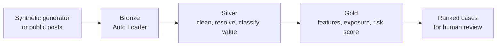

# Influencer Tax Risk Lakehouse

Say a restaurant invites an influencer to a free dinner and the influencer posts about it. Nobody paid anyone, but that dinner is still income in most tax systems. It's also very easy to miss: it never touches a bank account.

I wanted to see how far a data pipeline could get on this problem. This project takes posts, works out which ones look like undisclosed barter or sponsorship, estimates what the freebie was worth, and ranks creators so a human reviewer knows where to look first.

**Please read this part:** a public post can't prove anyone evaded taxes. This is a research prototype that ranks risk, it doesn't accuse anyone. Everything in the repo is synthetic data, and the tax rules in the config tables are placeholders, not tax advice.

## How it works

It's a standard medallion lakehouse on Databricks with Unity Catalog. The part I care most about is that nothing country-specific lives in the code. Disclosure hashtags, tax treatment and languages all come from config tables, and a single `country_code` job parameter picks which ones to use. Adding a country should mean adding rows, not rewriting notebooks.

| Notebook | What it does |
|---|---|
| `00`, `01` | Set up the catalog and the config tables |
| `02` | Generates a seeded synthetic world: venues, creators, posts, and a hidden ground truth |
| `03` | Loads new files incrementally with Auto Loader |
| `04` | Cleans posts, matches them to creators and venues, pseudonymizes identities |
| `05` | Classifies posts with simple rules and puts a low/mid/high value on each |
| `06`-`08` | Builds creator features, estimates tax exposure, and produces an explainable risk score |
| `07a` | Calibrates class probabilities from labeled data (run by hand) |
| `09` | Quality gate: stops the job if a data check fails |
| `10` | Measures everything against the ground truth |

The eight pipeline tasks run as one Databricks Workflow in about four minutes on serverless compute.

## What it found

On the synthetic Colombia run:

- It matches the right venue **91.6%** of the time. Most misses come from venues that share a name.
- The estimated total value of in-kind posts lands within **+0.9%** of the true total, and the true value falls inside the low-high range for **97.9%** of them.
- With 50 risky creators planted out of 200, the ranking gets **1.00, 0.96 and 0.74** precision at the top 10, 25 and 50.

These numbers are optimistic. The labels are synthetic and I calibrated and evaluated on the same ground truth.

## What I learned

- **Captions alone don't cut it.** Only 13% of the posts my rules flagged as "unclear" were actually in-kind. The rest were people genuinely praising a place they paid for. Recurrence, income gaps and images have to carry the rest of the weight.
- **Hashtags lie.** `#colaboración` showed up on paid posts and on barter posts, so one tag can't tell you which is which.
- **Interactive notebooks hide bugs.** A variable I'd deleted was still sitting in my session, so everything worked until I ran the notebooks as a job from a clean start.
- **Keep the answer key out of the pipeline.** The ground truth only gets read by the evaluation notebook, never by the code that makes predictions.

## Known gaps

- There's no separate holdout set for evaluation.
- In my generator, a creator's declared income doesn't depend on risk, so I can't yet test whether the income-gap signal works.
- About 13% of posts match more than one venue.
- The pseudonymization salt is a dev value. A real deployment needs a secret store.

## What's next

A second country in a different language, deployment with Databricks Asset Bundles and CI/CD, a real-data track with a small labeled sample, and LLM-based extraction.

## Privacy and ethics

Official APIs only, pseudonymized creator IDs, a human reviewing every case, and a data protection check for each country before touching real data.

## License

MIT